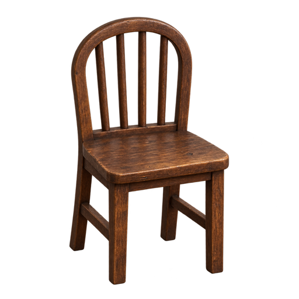
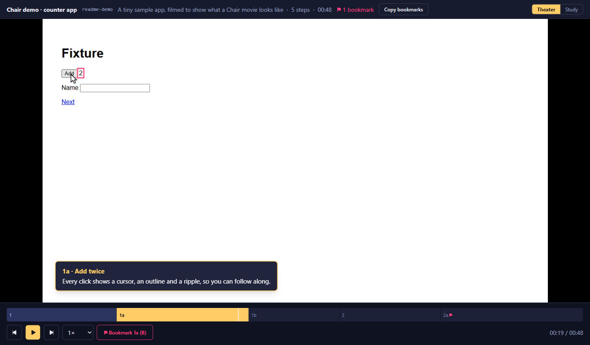
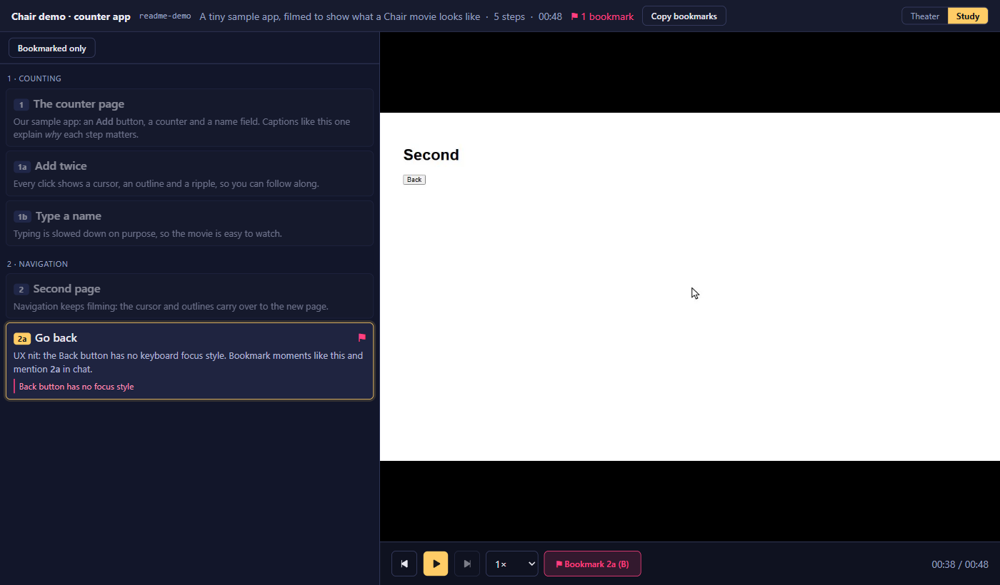

<p align="center">
  
</p>

<h1 align="center">Chair</h1>

<p align="center"><strong>Sit back and watch what your agent built.</strong></p>

When a coding agent builds something you don't know well, reading the diff is slow and reading its summary means trusting it. Chair lets the agent **film** the feature instead. It drives a real browser through the app and records a short, narrated movie, one numbered step at a time. You watch the movie, bookmark the moments that feel off, and then talk back in chat with step codes: "2f is wrong", "5d needs a warning".

<p align="center">
  
</p>

## How it works

1. **Plan.** The agent proposes parts and steps (`1`, `1a`, `1b`, `2`, …) and you approve them in chat.
2. **Rehearse.** It clicks through the flow fast with the camera off. Mistakes and retries are fine here.
3. **Take.** It films the same flow live, in real time, at a pace you can follow. Every click gets a visible cursor gliding to it, a pink outline and a ripple, and typing is slowed down. Each step's action starts straight away. The viewer stops at the start of every step so you can read the caption; that wait is not in the video. The camera only runs while a tool call is working, so the agent's thinking time never shows up. If something goes wrong mid-take, the agent cuts, repairs and retakes just that step.
4. **Watch.** `finish` assembles one `movie.mp4` and opens the viewer in your browser.

A movie is a one-time recording. If you want an updated version, the agent films a new one.

## The viewer

**Theater** (above) plays the movie like a film. The current step's caption sits in the corner, and the scrub bar is split into steps with their codes.

**Study** puts the step list on the left and the video on the right. The active step is highlighted and kept in view, and you can click any step to jump there. You can also just read it like a document.

<p align="center">
  
</p>

- **Bookmarks:** press `B` or click ⚑ to bookmark the current step, and add a short note if you like. Bookmarks are saved to `bookmarks.json` in the movie folder, so the agent can read them too.
- **Bookmarked only** turns the Study list into your review list.
- **Copy bookmarks** gives you text ready to paste into chat:

    ```
    Bookmarks — Chair demo · counter app (readme-demo)
    2a — Back button has no focus style
    ```

- **Stops at every step:** playback stops at the start of each step so you can read its caption, and goes on when you press Space or Play. Jumping to a step also lands paused at its start.
- **Download movie** saves an MP4 you can share, with each step's caption box burned in at the bottom left. It plays straight through; whoever watches it can pause it themselves.
- **Keyboard:** Space plays and pauses, ← / → jump between steps, `B` bookmarks. Speed goes from 0.5× to 2×.

## Install

Requires Node ≥ 26 and pnpm ≥ 11.

```sh
git clone https://github.com/MrCoft/Chair.git Chair
cd Chair
pnpm install
pnpm exec playwright install chromium
pnpm build
pnpm add -g .
```

`pnpm add -g .` links the clone into pnpm's global packages, so `chair` runs from this folder and picks up later pulls and builds. If pnpm's global bin folder is not on your PATH yet, run `pnpm setup` once and open a new terminal.

Register the MCP server with Claude Code:

```sh
claude mcp add chair -s user -- chair mcp
```

## Use

You don't film anything yourself: ask your agent for a movie. Its working guide, with the workflow, the tools, caption style and how to handle mistakes, is [docs/agent-guide.md](docs/agent-guide.md). A project can add its own skill on top, with app-specific helpers such as MUI pickers, login steps and where movies go.

The MCP server gives the agent 11 tools: `open`, `run`, `snapshot`, `screenshot`, `movie_start`, `step`, `cut`, `resume`, `retake`, `finish`, `close`.

To open a movie yourself:

```sh
chair view <dir> [--at <code>] [--port <n>] [--idle-exit <minutes>]
```

- **`<dir>`:** a movie folder, or a folder of movies (you get a list).
- **`--at 2f`:** opens the movie at that step.
- **Stopping:** `chair view` runs until Ctrl+C. With `--idle-exit 30` it stops by itself after 30 minutes without a request, which is how the viewer opened by `finish` runs.

`finish` also writes the download copy with captions. To make it again, or for a movie recorded before it existed:

```sh
chair export <movie dir>
```

## Movie folder

```
<movie>/
  movie.json       version 1: id, title, scope, parts, steps (code, title, caption, timing, actions)
  movie.mp4        the whole movie, one file, as the viewer plays it (captions are drawn by the viewer)
  movie-captioned.mp4  the download copy: the same video with the caption boxes burned in
  bookmarks.json   your bookmarks (empty at first; the viewer adds to it)
  raw/             working frames, present only while recording; finish removes it unless keepRaw is set
```

Each step also stores what the agent did (clicks, typing, with timestamps). So when you say "2f is wrong", the agent can see exactly what happened there.

Movies can show real screens and data, so keep them out of git (for example in a gitignored `.chair/` folder).

## Development

```sh
pnpm dev        # viewer dev server
pnpm test       # unit and component tests
pnpm test:e2e   # browser and ffmpeg tests
pnpm type && pnpm lint
pnpm build      # viewer build used by `chair view`
```

TypeScript throughout. The recorder uses Playwright with a CDP screencast and ffmpeg. The viewer is built with React 19, TanStack Start, Tailwind and shadcn/ui.

## License

[MIT](LICENSE)
